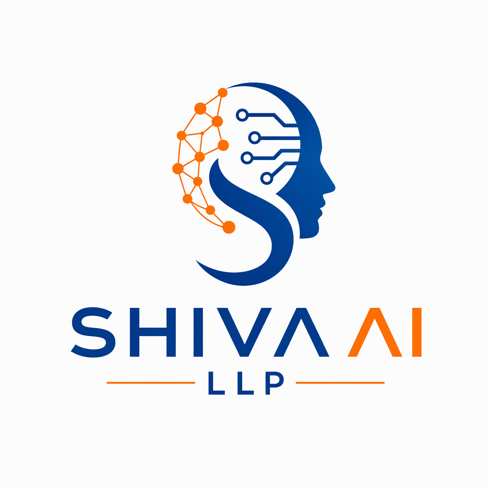

<div align="center">

  

  # Shivay AI LLP (Shiva AI LLP)
  ### Production-Grade Enterprise Artificial Intelligence & Autonomous Agentic Systems

  [](https://sal-amber.vercel.app)
  [](https://www.youtube.com)
  [-orange?style=for-the-badge&logo=shield)](https://sal-amber.vercel.app/#about)
  [](https://sal-amber.vercel.app/#contact)

  <br />

  <p align="center">
    <b>Shivay AI LLP</b> is an incorporated engineering partner building full-lifecycle AI systems for startups, growth-stage enterprises, and institutions worldwide. From domain-adapted LLMs and multi-agent workflows to sub-500ms voice telephony and high-precision RAG pipelines.
  </p>

</div>

---

## 📌 Executive Overview

Unlike generic prototype builders or surface-level prompt wrappers, **Shivay AI LLP** designs and deploys **production-grade enterprise infrastructure**. Every implementation is hardened for security, private cloud isolation, low latency, and continuous telemetry monitoring.

### 🏢 Key Corporate Assurances
- **100% Client IP Ownership:** Full transfer of proprietary source code, fine-tuned weights, embeddings, and architecture schematics.
- **Enterprise NDA Protection:** Strict data isolation. Zero client data is ever cached or utilized to train external third-party public models.
- **Multi-Cloud Portability:** Deployments optimized across AWS, Google Cloud (GCP), Microsoft Azure, or on-premise GPU clusters (NVIDIA / vLLM).
- **Verifiable System Demos:** Every core architecture is backed by reproducible benchmarks and recorded system walkthroughs.

---

## 🚀 Core Capabilities & Solutions

| Capability | Architecture & Stack | Enterprise Impact |
| :--- | :--- | :--- |
| **Autonomous Agentic Systems** | LangGraph, CrewAI, n8n, Python, Redis | Replaces complex manual workflows with autonomous planning, tool use, and self-correction loops. |
| **Voice AI & Telephony** | Twilio SIP, Vapi.ai, Deepgram Nova, ElevenLabs | Full-duplex conversational voice bots operating under 450ms latency with emotional inflection. |
| **Enterprise RAG Engines** | Pinecone, LlamaIndex, Cohere Rerank, BM25 | Hybrid dense/sparse vector retrieval with strict citation guarantees across millions of documents. |
| **n8n Automation Pipelines** | n8n Partner Integration, REST/GraphQL, Webhooks | Connects CRMs (Salesforce/HubSpot), ERPs, databases, and AI models into deterministic business processes. |
| **Custom LLM Fine-Tuning** | PyTorch, Hugging Face, LoRA / QLoRA, vLLM | Specialized domain-specific models for legal, financial, and healthcare contract analysis. |
| **Speech STT / TTS & Audio** | Whisper, Custom Acoustic Models, Diarization | High-accuracy transcription, custom brand voice cloning, and audio processing pipelines. |

---

## 📂 Repository Structure

```
SAL/
├── index.html           # Production-ready single-page portal with interactive case study modals & YouTube demos
├── server.ps1           # Zero-dependency local HTTP static server for Windows PowerShell
├── logo.png             # Official company logo (high-resolution mark)
├── ShivaY AI LLP.jpg    # 3D embossed brand crest and official identity asset
└── README.md            # Comprehensive corporate & repository documentation
```

---

## 🛠️ Local Development & Running the Website

The website is engineered with semantic HTML5, modern CSS custom properties, and vanilla JavaScript for lightning-fast loads without framework build overhead.

### Option 1: Native Windows PowerShell (Built-in)
Run the included zero-dependency PowerShell server:
```powershell
powershell -ExecutionPolicy Bypass -File .\server.ps1
```
The server will start listening at: `http://localhost:8080/`

### Option 2: Python HTTP Server
```bash
python -m http.server 8080
```

### Option 3: Node / npx
```bash
npx serve .
```

Open your browser and navigate to:
```
http://localhost:8080
```

---

## 🌐 Production Deployment

The project is pre-configured for automated continuous deployment:
- **Primary Host:** [Vercel](https://vercel.com)
- **Live URL:** [https://sal-amber.vercel.app](https://sal-amber.vercel.app)
- **Deployment Trigger:** Automatic build & deployment on every `git push origin main`.

---

## 🤝 Enterprise Consultation & Direct Inquiries

For project roadmaps, architecture discussions, or confidential NDA execution:

- **Corporate Entity:** Shivay AI LLP (Shiva AI LLP)
- **Direct Email:** [contact@shivaaillp.com](mailto:contact@shivaaillp.com)
- **Official GitHub:** [github.com/parmarjh/SAL](https://github.com/parmarjh/SAL)
- **YouTube Channel:** [Watch Architectural Walkthroughs](https://www.youtube.com)
- **Response SLA:** Within 24 business hours

---

<div align="center">
  <sub>&copy; 2026 Shivay AI LLP (Shiva AI LLP). All rights reserved. Intellectual Property & NDA Protected.</sub>
</div>
